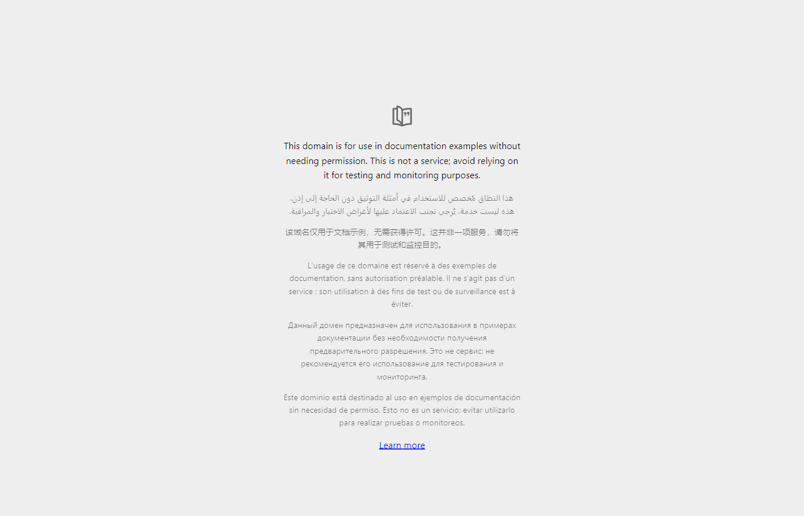
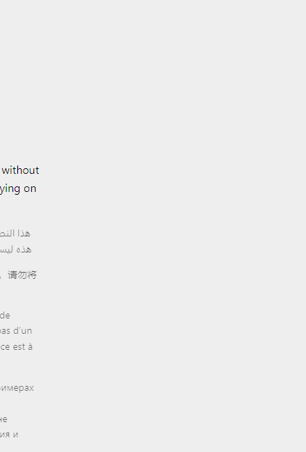

# bTab Sync

> **Browser productivity for developers and power users.**

Take control of your browser. Your entire workflow, organized in one place.


---

## 🎯 Who is bTab Sync for?

| User | How bTab helps |
|------|----------------|
| **Frontend Developer** | Switch between development environments instantly |
| **QA Engineer** | Record testing sessions and export tab history |
| **Backend Developer** | Organize API documentation and project tabs |
| **Automation Tester** | Maintain separate testing workspaces |
| **Freelancer** | Separate client projects with colored workspaces |
| **Researcher** | Save and restore research sessions |
| **Power User** | Manage 100+ tabs without RAM meltdown |

---

## 💎 Get bTab Sync Pro

<p align="center">
  <strong>₹2,999</strong> — Introductory Lifetime Price<br>
  <sub>Regular price ₹3,999 after launch</sub>
</p>

<p align="center">
  <a href="https://btab.lemonsqueezy.com/buy/btab-sync-pro">
    
  </a>
</p>

✅ All 14 Pro features forever  
✅ Chrome & Firefox support  
✅ Lifetime updates included  
✅ 30-day money-back guarantee

---

## 🚀 What makes bTab different?

Most tab managers focus on saving, organizing, and grouping tabs.

**bTab Sync is a browser productivity platform** with features that make it a daily toolkit for software professionals:

### Tier 1 — Major differentiators

| Feature | What it does |
|---------|--------------|
| **🎬 Test Session Recorder** | Record browsing sessions with timestamps, export to JSON for QA |
| **🌐 Environment Switcher** | One-click switch between dev/staging/prod URLs |
| **🎨 Project Workspaces** | Save tab collections with emoji icons and color coding |
| **⚙️ Automation Rules** | Create up to 10 rules (idle → sleep, heavy → notify) |
| **📊 Memory Dashboard** | Visual RAM usage with top 10 tabs ranked |
| **💤 Smart Auto-Suspension** | Automatically sleep idle tabs (configurable threshold) |

### Tier 2 — Retention features

| Feature | What it does |
|---------|--------------|
| **📝 Quick Tab Notes** | Attach notes to any URL — persists across sessions |
| **⏰ Tab Reminders** | Get notified to revisit important tabs |
| **⏪ Tab Time Machine** | 30-day history of closed tabs |
| **🛡️ Suspension Exceptions** | Whitelist domains that should never sleep |
| **📂 Tab Auto-Grouping** | Chrome tab groups by domain (native API) |

### Tier 3 — Core improvements

| Feature | What it does |
|---------|--------------|
| **🧠 Smart Duplicate Detection** | Ignores UTM params, trailing slashes |
| **📅 Tab Expiry** | Flags tabs not visited in 7+ days |
| **📁 Tab Workspaces** | Basic save/restore tab collections |

---

## 📸 Screenshots

<p align="center">
  
</p>

<p align="center">
  <em>Clean, elegant command center with memory badges and status indicators</em>
</p>

### Dark & Light Themes

| Dark Theme | Light Theme |
|:---:|:---:|
|  |  |

### Features in Action

| Memory Dashboard | Cleanup Panel |
|:---:|:---:|
|  |  |
| Visual memory usage with top tabs | One-click browser optimization |

---

## ✨ Free Features

| Feature | Description |
|---------|-------------|
| **🔍 Smart Search** | Multi-word AND matching with highlighted results |
| **📌 Pin Protection** | Pinned tabs can't be closed or purged |
| **🧹 One-Click Cleanup** | Close duplicates, sleep idle, handle heavy tabs |
| **🎯 Focus Mode** | Filter to current window only |
| **🔄 Recently Closed** | Quick restore with timestamps |
| **🌍 10 Languages** | EN, HI, TA, ES, FR, DE, PT-BR, JA, ZH-CN, AR |
| **🎨 Dark/Light Themes** | System sync supported |

---

## ⌨️ Keyboard-First Design

| Shortcut | Action |
|----------|--------|
| Click toolbar icon | Open bTab Sync panel |
| `↑` / `↓` | Navigate tabs |
| `Enter` | Switch to selected tab |
| `Escape` | Close panel / Exit focus mode |

### Commands (type in search bar)

| Command | Action |
|---------|--------|
| `/focus` | Filter to current window |
| `/purge` | Close all non-pinned idle tabs |
| `/stale` | Show only stale/idle tabs |
| `/audio` | Show tabs playing audio |

---

## 🔒 Privacy-First Architecture

**Your tabs. Your data. Your browser.**

- **100% local** — all data stays on your device
- **No backend** — no servers, no accounts
- **No tracking** — zero analytics or telemetry
- **No ads** — clean, distraction-free
- **Open source** — audit the code yourself

When you enable Google Drive backup (optional), data goes to **your** Drive `appDataFolder`. We never see it.

---

## 🆚 Why not [competitor]?

| Feature | bTab Sync | OneTab | Workona | Tab Suspender |
|---------|:---------:|:------:|:-------:|:-------------:|
| Memory optimization | ✅ | ❌ | ❌ | ✅ |
| Project workspaces | ✅ | ❌ | ✅ | ❌ |
| Test session recorder | ✅ | ❌ | ❌ | ❌ |
| Environment switcher | ✅ | ❌ | ❌ | ❌ |
| Automation rules | ✅ | ❌ | ❌ | ❌ |
| Keyboard-first | ✅ | ❌ | ⚠️ | ❌ |
| 100% local/private | ✅ | ✅ | ❌ | ✅ |
| One-time purchase | ✅ | ✅ | ❌ | ✅ |
| Cross-browser | ✅ | ✅ | ❌ | ⚠️ |

---

## 📦 Installation

### Chrome
1. Download from Chrome Web Store (coming soon)
2. Or: `chrome://extensions` → Developer mode → Load unpacked

### Firefox
1. Download from Firefox Add-ons (coming soon)
2. Or: `about:debugging` → Load Temporary Add-on

---

## 🛠️ Development

```bash
# Clone
git clone https://github.com/BalaKrishnan071194/btab-sync.git
cd btab-sync

# Install
npm install

# Dev build with watch
npm run dev

# Production build
npm run build
```

### Tech Stack
- React 18 + TypeScript
- Tailwind CSS + Framer Motion
- Vite build tool
- IndexedDB for local storage
- Lucide icons

---

## 💎 Pricing

| Plan | Price | Features |
|------|-------|----------|
| **Free** | ₹0 | Smart search, cleanup, focus mode, pin protection |
| **Pro Monthly** | ₹199/mo | All 14 Pro features |
| **Pro Annual** | ₹999/yr | All 14 Pro features (save 58%) |
| **Pro Lifetime** | ₹2,999 | All 14 Pro features forever *(introductory)* |

<p align="center">
  <a href="https://btab.lemonsqueezy.com/buy/btab-sync-pro"><strong>🚀 Get Pro — ₹2,999 Lifetime</strong></a>
</p>

30-day money-back guarantee. No questions asked.

---

## 📄 License

MIT License — see [LICENSE](LICENSE) for details.

---

<p align="center">
  <strong>bTab Sync</strong><br>
  Take control of your browser.
</p>

<p align="center">
  Made with ❤️ for developers who deserve better browser productivity.
</p>
